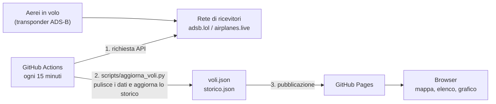

# ✈️ Radar Voli Napoli

Gli aerei che volano entro 74 km dall'aeroporto di Napoli Capodichino, su una mappa che si aggiorna da sola ogni 15 minuti.

**Sito:** https://carminedavino51-art.github.io/radar-voli-napoli/

Per ogni aereo mostra nominativo, compagnia, modello, quota, velocità e rotta. In più: le statistiche del momento, il traffico delle ultime 24 ore e le compagnie più viste. Se un aereo trasmette un codice di emergenza (squawk 7500, 7600 o 7700), il sito lo segnala in rosso.

## Come funziona



1. Gli aerei trasmettono la loro posizione con il transponder **ADS-B**. Una rete di appassionati la riceve e la rende disponibile tramite API pubbliche.
2. Ogni 15 minuti **GitHub Actions** avvia lo script Python `scripts/aggiorna_voli.py`. Lo script scarica gli aerei intorno a Napoli, tiene solo i campi utili e calcola la distanza da Capodichino.
3. Lo script aggiorna anche lo **storico delle ultime 24 ore**: rilegge quello già pubblicato, aggiunge il dato nuovo e scarta i dati più vecchi.
4. Il sito viene ripubblicato su **GitHub Pages**. La pagina legge i due file JSON e disegna mappa, elenco, statistiche e grafico.

## Scelte tecniche

**Perché i dati non arrivano direttamente dal browser.** Le API dei voli non inviano l'intestazione `Access-Control-Allow-Origin`, quindi il browser blocca le richieste fatte da un altro sito (policy **CORS**). Per questo la raccolta dei dati avviene lato server, in un job schedulato di GitHub Actions. Il browser legge solo file dello stesso sito.

**Niente server e niente database.** Tutto gira sui servizi gratuiti di GitHub. Lo storico è un file JSON che a ogni esecuzione viene riletto dal sito pubblicato e aggiornato, quindi il repository non si riempie di commit automatici.

**Affidabilità.** Ci sono due fonti con lo stesso formato dati: se `adsb.lol` non risponde, lo script usa `airplanes.live`. Se falliscono entrambe, lo script esce con errore e la pubblicazione non parte, quindi sul sito restano gli ultimi dati validi. La pagina mostra l'ora dell'ultimo aggiornamento e diventa gialla se i dati hanno più di 45 minuti.

**Sicurezza.**
- I testi che arrivano dall'esterno (es. il nome di un volo) passano da `escapeHTML()` prima di finire nella pagina, per evitare attacchi **XSS**.
- La libreria Leaflet è caricata con il controllo di integrità **SRI**: se il file sul CDN venisse alterato, il browser si rifiuterebbe di eseguirlo.
- Il workflow ha solo i permessi che gli servono (`contents: read`, `pages: write`).

## Struttura

```
.github/workflows/aggiorna.yml   automazione: ogni 15 minuti scarica i dati e pubblica
scripts/aggiorna_voli.py         raccolta dati (Python, solo libreria standard)
sito/index.html                  struttura della pagina
sito/style.css                   grafica
sito/app.js                      mappa (Leaflet), elenco, statistiche, grafico su canvas
```

## Provarlo sul proprio computer

Serve Python 3.

```bash
python scripts/aggiorna_voli.py          # crea sito/data/voli.json e storico.json
python -m http.server 8000 --directory sito
```

Poi apri http://localhost:8000 nel browser.

## Tecnologie

Python 3 · JavaScript · HTML/CSS · [Leaflet](https://leafletjs.com) · GitHub Actions · GitHub Pages · API REST · JSON

## Fonti e licenze

- Dati ADS-B: [adsb.lol](https://adsb.lol) (licenza ODbL) e [airplanes.live](https://airplanes.live) (uso non commerciale).
- Mappa: © [OpenStreetMap](https://www.openstreetmap.org/copyright), © [CARTO](https://carto.com/attributions).
- Progetto dimostrativo, non adatto alla navigazione aerea.

---

Progetto di **Carmine D'Avino** · [Portfolio](https://carminedavino51-art.github.io/) · [LinkedIn](https://www.linkedin.com/in/carmine-d-avino-1418063a8)
